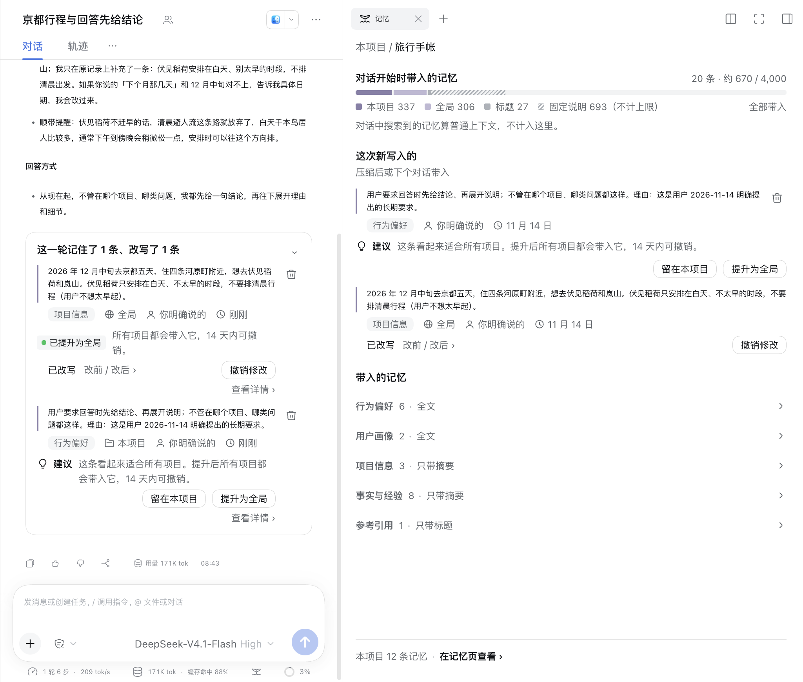
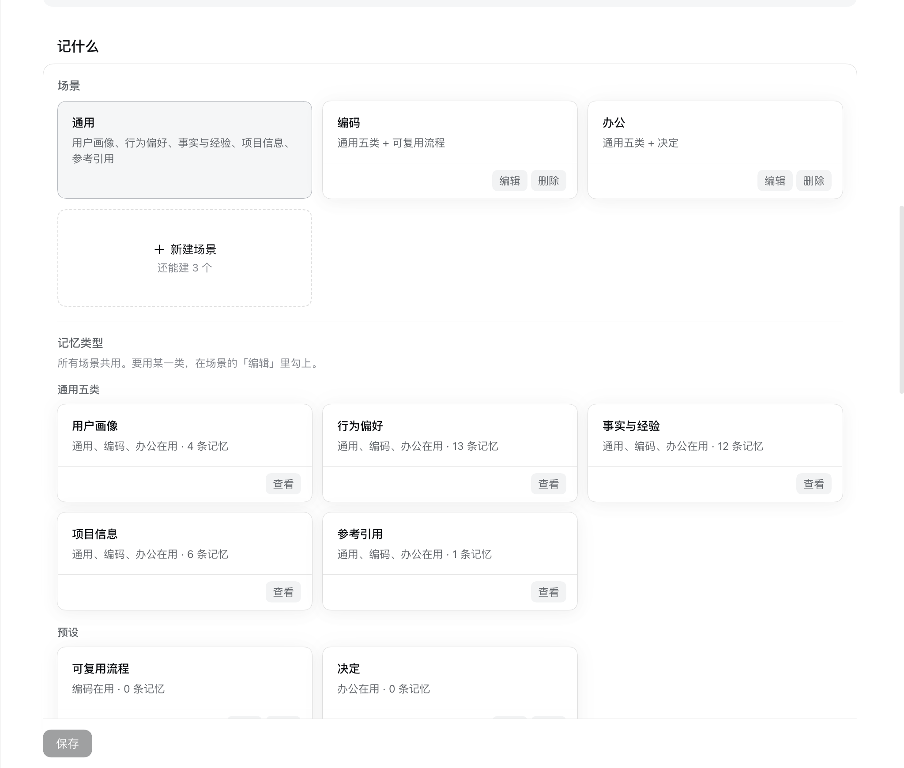
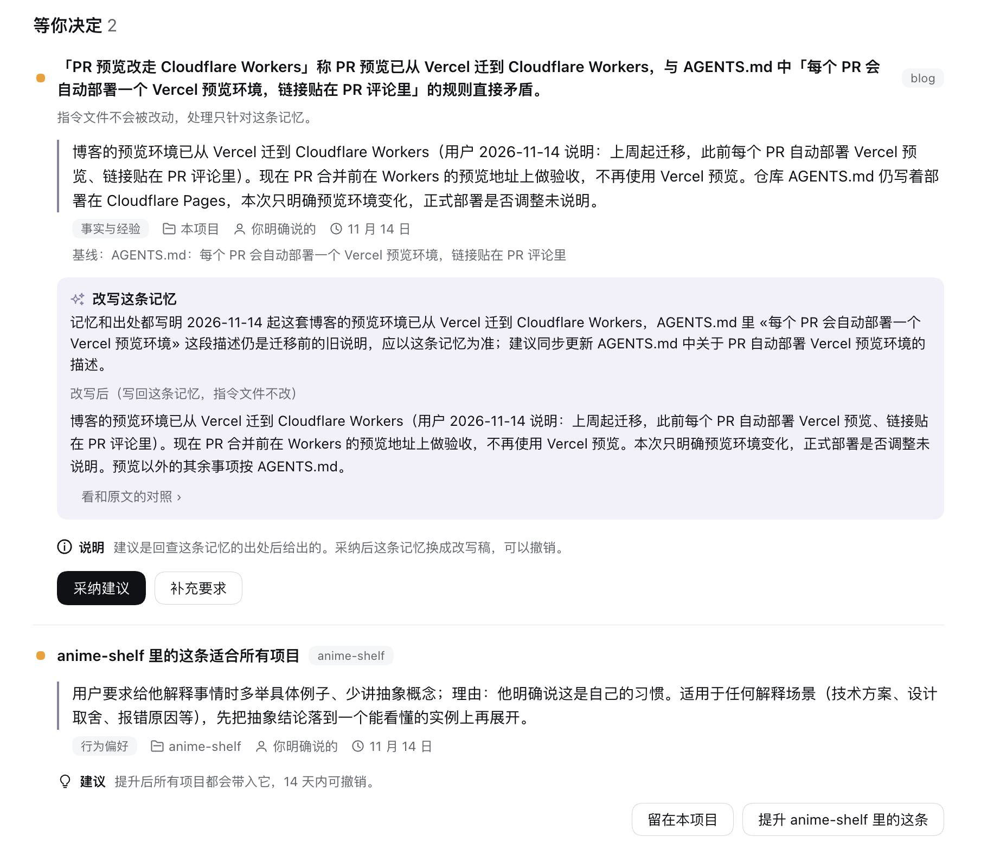

<div align="center">


*"I'm scared. Sometimes I even think it would have been better to have none of these memories from the start. If memories didn't keep piling up, and I were just something that ran on its program, how much easier that would be." — Isla, Plastic Memories*

# dsh-plastic-memory

**Plastic Memories · a long-term memory plugin for DeepSeek Harness**

[简体中文](README.md) · **English**


[Installation](#installation) · [Getting started](#getting-started) · [Guides](#guides)

</div>

A long-term memory plugin for [DeepSeek Harness](https://github.com/deepseek-ai/deepseek-harness) that saves memories automatically, brings them back when needed and keeps them in good health. It notes the information worth keeping from everyday chats and tasks, offers that context in later work, and maintains the quality of what it remembers through regular health checks.

## What it does

- **Saves on its own**  
Your habits and preferences, lessons learned, project background and workflows are noted by the model as you chat, each marked as something you said explicitly or something the model observed or inferred. Every memory is a Markdown file stored per project; when one fits every project, the plugin suggests promoting it to a global memory.
- **Recalls when needed**  
A new chat starts with the core memories and an index already loaded. During the chat the model searches for more relevant memories as needed, and when necessary goes back to the conversation a memory came from.
- **Regular checkups**  
Checkups look for duplicates, contradictions, outdated and overly long memories within a project, and between project memories, global memories and `AGENTS.md`, then give a health score and suggestions. Run one by hand or schedule automatic checkups.
- **Always visible**  
When a chat adds or updates memories, a card appears under the reply so you can deal with them on the spot. The whale-tail icon below the input box shows memory usage and counts; the right sidebar shows the memories brought in at the start of this chat and the ones written along the way. Problems found by a checkup light up the Memory entry at the top left, which opens the page for reviewing and handling memories.
- **Your own setup**  
General, Coding and Office modes are built in, and you can define your own scenes and memory types, choosing what gets remembered and how. The injection budget, source lookup and health reminder sensitivity are all adjustable on the settings page.

<table>
  <tr>
    <td width="33%"></td>
    <td width="33%"></td>
    <td width="33%"></td>
  </tr>
  <tr>
    <td align="center">Chat card and right sidebar</td>
    <td align="center">Settings page: scenes and memory types</td>
    <td align="center">Memory page: suggestions for conflicts and promotions</td>
  </tr>
</table>

## Design principles

- **Recording matters; upkeep matters more**  
Saving and searching are only part of long-term memory. Over time, duplicate, conflicting and outdated memories pile up and start to lead the model astray. Checking memory health, resolving contradictions and letting stale information go are just as much part of the job.
- **You make the key calls**  
The model proposes how to maintain and improve your memories, and nothing is carried out until you confirm. The model proposes and executes; the key decisions stay with you.
- **Every bit of your attention counts**  
Working with an agent comes down to where your attention goes. Most of the time the plugin and the model handle saving, searching and automatic checkups in the background without you. The cards in the chat start folded, and together with the right sidebar and the Memory entry at the top left they keep memory in view without breaking your flow, ready to expand and drill into whenever you want to look or step in. When a checkup finds problems, the items that need you are sorted by priority, so your effort goes to the decisions that matter most. As models get more capable, the plugin will take on more of the work and ask for confirmation less often.
- **Plastic memories**  
Everyone works with agents in their own way, and memory shouldn't be a rigid preset template. Beyond the ready-to-use base modes, the plugin lets you adjust how memory runs through custom scenes and types and the options on the settings page. The plugin is still at an early stage and many parts still need work; more combinable modules are planned to make it more freely plastic and help you build the memory that fits you best.

## Installation

Requires DeepSeek Harness v0.2.2-rc.1 or later. Both the desktop app and the web version are supported; the desktop app currently gives the best experience.

**Desktop app (recommended)**: open the Plugins page in the sidebar, click Add plugin, enter `dsh-plastic-memory@0.2.0-beta.3` and confirm.

**Web version**: add it on the Plugins page as well; pnpm must be installed on your machine.

**Command line**: replace `web` with the profile you want to install into, then restart.

```bash
dsh plugin --profile web add dsh-plastic-memory@0.2.0-beta.3
```

Installation details and upgrade notes

- To install into the desktop app from the command line (`--profile desktop`): open the desktop app once, quit it completely, run the command, then reopen the app. Other profiles are created automatically if they don't exist. Either the npm-installed `dsh` or the one bundled with the desktop app works.
- Runtime: Node.js `^22.19.0 || >=24`.
- Upgrading from 0.1.x keeps your existing memories in place and migrates pending items automatically; profiles that share a memory folder should upgrade together, since older versions cannot read upgraded memories that have a validity period. 0.2.0 requires DeepSeek Harness v0.2.2-rc.1 or later; on an older DeepSeek Harness, upgrade it before installing this plugin.
- DeepSeek Harness is still in pre-release and may ship breaking changes. Before upgrading DeepSeek Harness, check the supported versions in this document and the changelog.

## Getting started

1. **Chat as usual** and the plugin notes what is worth remembering. Each time it saves something, a small card appears under the reply: open it to see what was saved, delete it right there, or jump to the Memory page to edit it further.
2. **Start a new chat** and click the whale-tail icon below the input box to see how many memories this chat brought in and wrote. Open the Memory tab in the right sidebar to see exactly which memories were injected and which were written along the way.
3. **Open the Memory entry at the top left** to browse global memories and every project's memories in one place. You can search, edit and delete them, and recover anything deleted in the last 14 days.
4. **Try a checkup**: click Check now or set up Auto checkup. Issues that need you are collected under To do with carefully analysed suggestions, and the final call is yours.

## Guides

The guides are currently available in Chinese only.

| Guide | Contents |
| --- | --- |
| [Everyday interface guide](https://github.com/KKL08/dsh-plastic-memory/blob/main/guide/interface.md) | The Memory page, right sidebar, chat cards and settings page, and what each can do |
| [Memory types and scenes](https://github.com/KKL08/dsh-plastic-memory/blob/main/guide/memory-types.md) | The five base types, scenes, how memories are brought in, custom types, rules for subagent memories |
| [Files and manual editing](https://github.com/KKL08/dsh-plastic-memory/blob/main/guide/files.md) | Where memories live, what the files look like, what to watch for when editing by hand |
| [Configuration](https://github.com/KKL08/dsh-plastic-memory/blob/main/guide/configuration.md) | Every option in `cordis.patch.yml` |
| [Architecture and tools](https://github.com/KKL08/dsh-plastic-memory/blob/main/guide/how-it-works.md) | How memories are written, brought in and maintained, and the nine tools the model can use |
| Contributing | Docs in progress |

## Data and privacy

- Memories are stored as local files on your device, by default under `~/.dsh/memories`.
- Memories brought into a chat, and memories examined during a checkup, are sent to the model service you use in DeepSeek Harness.
- The plugin blocks secrets (such as `sk-…`) from being written; content that looks like a secret is saved only after you confirm. Secrets already in your memories, or written by accident, are masked when brought into a chat or shown in the interface, and checkups flag them as the highest-priority risk.

## Where the name comes from

The plugin is named after the anime *Plastic Memories*.

In the series, Giftias are androids with human-like feelings and personalities of their own, and their minds have a strict lifespan of **81,920 hours (about 9 years and 4 months)**. Past that limit, without proper care and retrieval, their memory storage falls into severe disorder until they lose their minds and turn into uncontrollable Wanderers.

An agent's long-term memory faces a similar fate: if memories are only ever written and never maintained, outdated, contradictory and redundant ones pile up, crowding the context budget and leading the model astray. So beyond remembering and searching, this plugin gives agent memory **plasticity and a lifecycle**, putting the quality and upkeep of memories first, so that valuable memories stay fresh and stale information steps aside in good order.

| In *Plastic Memories* | In the plugin |
| :--- | :--- |
| **Isla's diary** | Memories captured from everyday chats and kept as local Markdown files, one per memory |
| **Wanderers out of control** | Degraded memories that pile up over time, contradict each other, go stale and lead the model astray |
| **SAI Corp. Terminal Service No. 1** | Regular health checks, cross-checking and cleanup of the memory library |
| **Spotter and Marksman partnership** | The model proposes and executes; key calls such as retrieval, cleanup and promotion to global are yours |
| **Revisiting the first meeting** | Memory provenance: when needed, the model goes back to the conversation a memory came from to check it |

## License

[MIT License](LICENSE)

If this project helps you, a ⭐ would be much appreciated.
