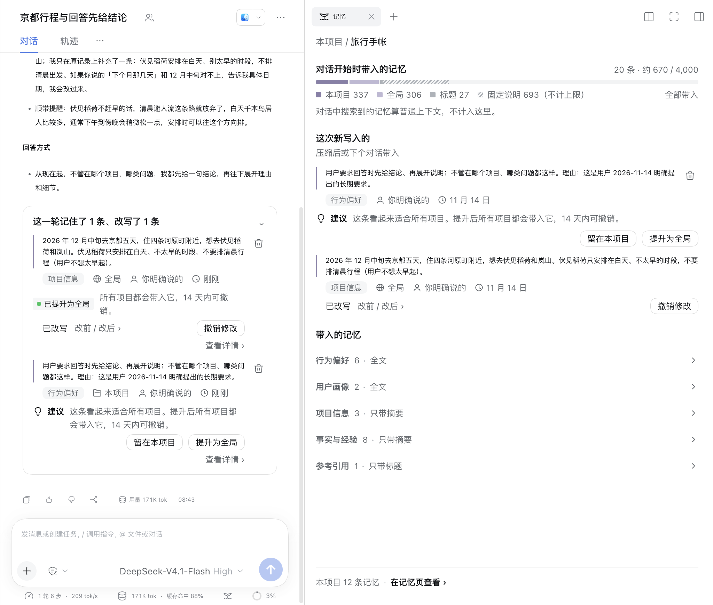
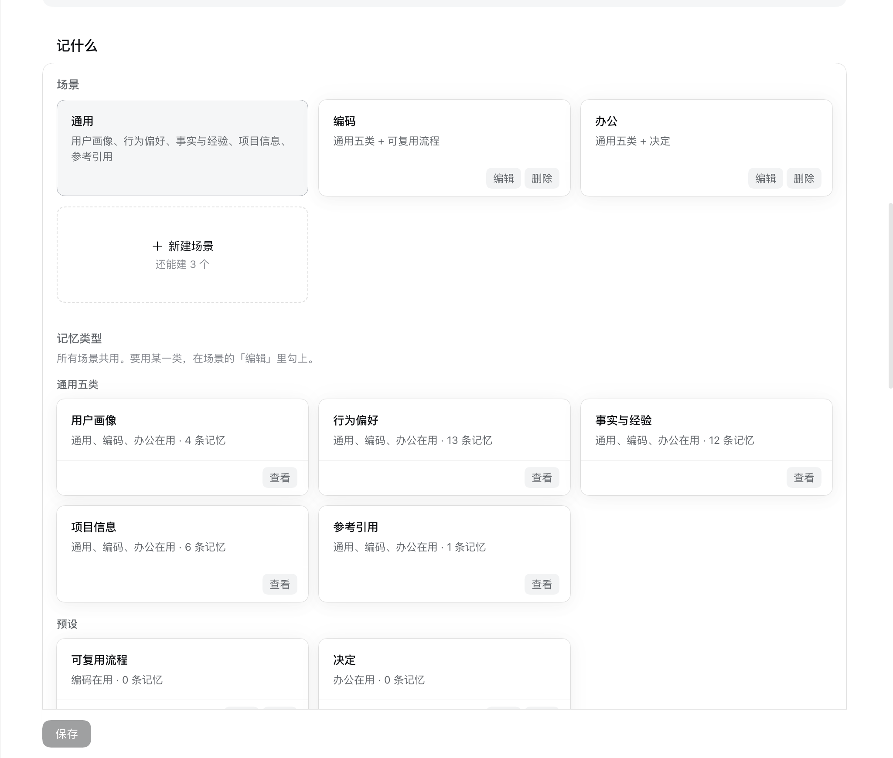
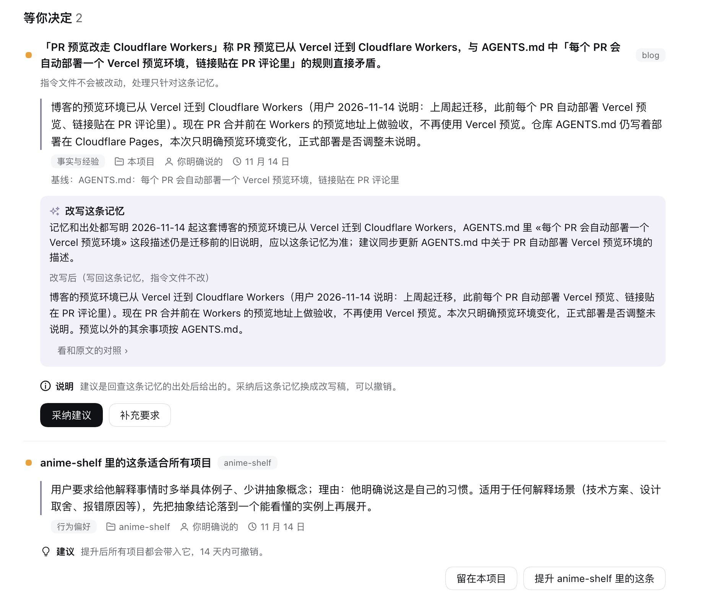

<div align="center">


*“我很害怕。有时候甚至会想，如果从一开始就没有这些回忆就好了。如果记忆不会不断积累，自己只是一个依照程序自动运转的存在，那该有多轻松啊。”——艾拉《可塑性记忆》*

# dsh-plastic-memory

**可塑性记忆 · DeepSeek Harness 的长期记忆插件**

**简体中文** · [English](README.en.md)


[安装](#安装) · [上手](#上手) · [使用指南](#使用指南)

</div>

这是一款面向 [DeepSeek Harness](https://github.com/deepseek-ai/deepseek-harness) 的长期记忆插件，集记忆的自动沉淀、按需唤起与质量维护于一体。它能在日常对话与任务中记下值得保存的关键信息，在后续协作中适时提供上下文背景，并通过健康监测机制持续维护记忆内容质量。

## 它能做什么

- **自动沉淀**  
你的习惯偏好、经验教训、项目背景与流程等，模型会在对话中自动记下，并标记该内容是由你明确提出，还是由模型观察推测得出。每条记忆是一个 Markdown 文件，按项目存放；适合所有项目的，会建议你提升为全局记忆。
- **按需唤起**  
开启新对话时自动注入核心记忆内容与索引。对话过程中也会动态按需检索更多相关记忆库内容，在必要情况下会进一步下钻到原始出处。
- **定期体检**  
自动分析项目内的记忆之间、项目记忆与全局记忆和 `AGENTS.md` 之间存在的重复、矛盾、过期、冗长等问题，并给出健康评分与处理建议。可手动触发，也可设为定期自动巡检。
- **全程感知**  
对话中新增或更新记忆，在模型输出内容下方会浮现提示卡片，可以直接对记忆内容进行处理；点击输入框下方的鲸尾小图标可查看记忆用量与条数，打开右侧边栏则能看到本轮对话开头注入的记忆与过程中新写入的记忆；体检中发现的记忆问题会在左上方的「记忆」栏亮起提醒，点击可进入记忆处理与查看界面。
- **灵活定制**  
内置通用、编码、办公三种模式，也支持自定义场景与记忆类别。记什么，怎么记都可由你按需设置组合。注入预算、溯源策略与记忆健康提醒灵敏度，均可在设置页按需调节。

<table align="center">
  <tr><td></td></tr>
  <tr><td align="center">对话卡片和右侧栏</td></tr>
</table>

<table align="center">
  <tr><td></td></tr>
  <tr><td align="center">设置页：场景和记忆类型</td></tr>
</table>

<table align="center">
  <tr><td></td></tr>
  <tr><td align="center">记忆页：记忆优化建议</td></tr>
</table>

## 设计理念

- **重记录，更重治理**  
记录和检索只是长期记忆的一部分，随着时间推进，记忆重复、冲突、过期等问题越积越多，反而会把模型带偏。对记忆内容进行健康度检查，处理优化记忆矛盾，适时清理遗忘陈旧信息也是长期记忆机制的重要一环。
- **关键抉择由你拍板**  
模型会对记忆内容维护优化给出建议方案，由你确认后才会执行。模型负责提议和执行，但关键的抉择由人来把控。
- **你的每一分注意力都是宝贵的**  
与 Agent 协作的核心在于人的注意力如何合理分配。绝大多数时候，插件与模型会在后台处理好记忆的写入、检索与自动体检，无需人工干预；对话中的提示卡片默认收起，配合右侧栏状态与左上角的管理入口，提供轻度的记忆机制感知，不打断对话任务节奏，当你认为需要查看或介入时又能快速展开、直接下钻。当健康机制监测到质量问题时，待处理事项会按优先级自动排序，让你的精力花在最关键的决策上。随着模型能力的不断提升，后续记忆插件会主动承担更多任务，进一步减少需要人为确认的环节。
- **可塑性记忆**  
每个人与 Agent 协作的方式都不尽相同，记忆不该是一套死板的预设模板。插件在提供开箱即用的基础模式之外，也支持通过自定义场景与类别以及设置页选项按需调整记忆的运行策略。目前插件仍处于早期阶段，很多地方有待进一步优化，后续会设计更多可组合的模块，增强自由可塑性，帮你搭建最契合自己的个性化记忆。

## 安装

需要 DeepSeek Harness v0.2.2-rc.1 及以上版本。桌面版和 web 版都支持，目前桌面版的体验最佳。

**桌面版（推荐）**：打开侧边栏的「插件」页，点「添加插件」，输入 `dsh-plastic-memory@0.2.0-beta.4`，确认后安装。

**web 版**：同样在「插件」页添加，需要本机装有 pnpm。

**命令行**：把 `web` 换成你要装进的 Profile 名，装完重启。

```bash
dsh plugin --profile web add dsh-plastic-memory@0.2.0-beta.4
```

安装细节和升级说明

- 如果用命令行装进桌面版（`--profile desktop`）：先打开一次桌面版，完全退出后再运行命令，装完重新打开。其他 Profile 不存在时会自动创建。`dsh` 命令用 npm 装的或桌面版自带的都可以。
- 运行环境：Node.js `^22.19.0 || >=24`。
- 从 0.1.x 版本升级后原有记忆存储会继续沿用，待处理事项自动迁移；共用同一个记忆目录的多个 Profile 请一起升级，旧版本读不了升级后带有效期的记忆。0.2.0 要求 DeepSeek Harness v0.2.2-rc.1 及以上，旧版本 DeepSeek Harness 请先升级再安装本插件。
- DeepSeek Harness 仍在预发布阶段，之后可能有破坏性更新。升级 DeepSeek Harness 前，请注意本文档和更新日志里有关本插件支持的版本信息。

## 上手

1. **像平时一样聊天**，插件会自动把值得记的内容记下来。每次触发记录时，回复下方都会出现一张小卡片，点开即可查看记了什么，也能直接删除，或快捷跳转到记忆页进一步修改。
2. **开个新对话**，点击输入框下方的鲸尾小图标，可以看到本轮带入和新写入的记忆条数；打开右侧栏的「记忆」标签页，就能看到具体注入了哪些记忆、过程中又新写入哪些记忆。
3. **打开左上角「记忆」栏**，全局记忆和各个项目的记忆均可在此集中查看，支持搜索、修改、删除，也能随时找回最近 14 天内删除的记忆。
4. **尝试体检一次**，点击「立即体检」或设定「自动体检」。需要你处理的问题会汇总在「处理」栏里，附带经过深度分析的处理建议，但最终抉择由你拍板。

## 使用指南

| 文档                                                                                     | 内容                                 |
| -------------------------------------------------------------------------------------- | ---------------------------------- |
| [常用界面指南](https://github.com/KKL08/dsh-plastic-memory/blob/main/guide/interface.md)       | 记忆页、右侧栏、对话里的卡片、设置页，每处能做什么          |
| [记忆类型与场景](https://github.com/KKL08/dsh-plastic-memory/blob/main/guide/memory-types.md) | 五类基础记忆、场景、带入方式、自定义类型、子 agent 的记忆规则 |
| [文件与手动编辑](https://github.com/KKL08/dsh-plastic-memory/blob/main/guide/files.md)        | 记忆存在哪、文件长什么样、手改要注意什么               |
| [配置参考](https://github.com/KKL08/dsh-plastic-memory/blob/main/guide/configuration.md)   | `cordis.patch.yml` 里的每个配置项         |
| [基本架构和工具](https://github.com/KKL08/dsh-plastic-memory/blob/main/guide/how-it-works.md) | 记忆怎么写入、带入、治理，以及模型能用的九个工具           |
| 参与贡献                                                                                   | 相关文档完善中                            |

## 数据与隐私

- 记忆以本地文件形式存储在你的设备上，默认在 `~/.dsh/memories`。
- 带进会话的记忆、体检时检查的记忆，会发给你在 DeepSeek Harness 里用的模型服务。
- 插件会主动拦截密钥信息（如 `sk-…`）的写入；疑似密钥的内容需经你确认后才会保存。已存在于记忆中或者意外写入的密钥，在带入对话和界面展示时会被遮盖，并在体检中作为最高优先级风险提示。

## 名字的由来

插件名取自动画《可塑性记忆》（Plastic Memories）。

在原作中，拥有人类般感情和自主人格的智能机器人 Giftia，其心智寿命被严格限制在 **81,920 小时（约 9 年 4 个月）**。一旦超过期限而没有妥善的维护与回收，内部的记忆存储便会发生严重错乱，最终丧失理智、异化为失控的“徘徊者（Wanderer）”。

Agent 的长期记忆也有着相似的宿命：如果只管写入、不管维护，过期、矛盾、冗余的记忆就会越积越多，不仅挤占上下文预算，还会把模型带偏。所以这个插件除了“记住”与“检索”，还会赋予 Agent 记忆**可塑性（Plasticity）与生命周期（Lifecycle）**，重视记忆质量维护和治理，让有价值的记忆历久弥新，让失效的信息有序退场。

| 《可塑性记忆》里的设定                  | 插件里对应的机制                           |
| :--------------------------- | :--------------------------------- |
| **艾拉的日记本**                   | 在日常对话中自动捕捉记忆，并以一篇篇本地 Markdown 文件保存 |
| **失控的“徘徊者”**                 | 长期堆积后互相冲突、陈旧过期、把模型带偏的劣化记忆          |
| **SAI 社第 1 终端服务部**           | 定期对记忆库进行健康体检、交叉比对与清理优化             |
| **Spotter 与 Marksman 搭档协作制** | 模型负责具体的提议与执行，而回收清理、升为全局等关键决策由你拍板   |
| **重温最初相遇的记忆**                | 支持记忆溯源，必要时会下钻回查某条记忆出自哪段原始对话进行分析判断  |

## License

[MIT License](LICENSE)

如果这个项目对你有帮助，欢迎点个 ⭐ 支持一下。
