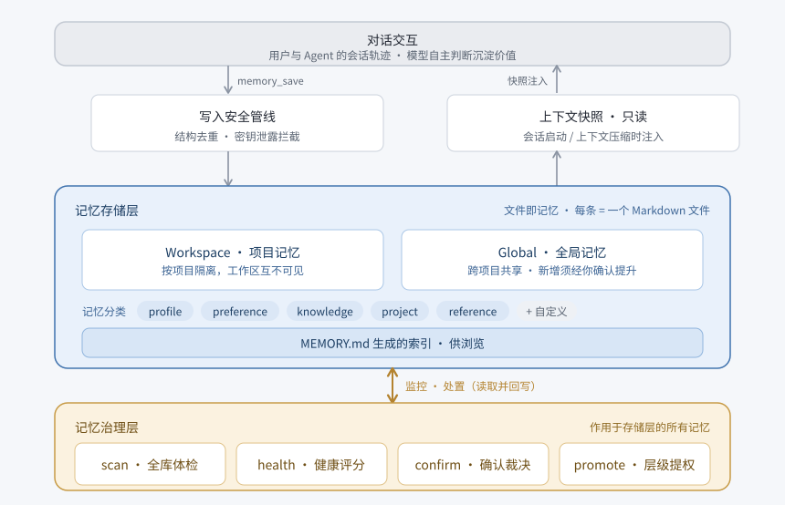

# 基本架构和工具

[返回首页](../README.md)

## 工作原理

<table>
  <tr>
    <td></td>
  </tr>
  <tr>
    <td align="center">架构概览</td>
  </tr>
</table>

**工作流简述：** 对话中模型触发 `memory_save` 提炼有效记忆节点，写入前通过安全管线去重并拦截密钥泄露。记忆保存为 Markdown 文件，在会话启动或上下文压缩时以只读快照形式精准注入。存储层之上叠加治理层，通过手动或定期体检发现问题、给出建议，经你确认后处置，抑制上下文退化与规则漂移。

## 模型可用的工具

### 日常交互工具

| 工具                | 用途与特性                                               |
| ----------------- | --------------------------------------------------- |
| `memory_save`     | 沉淀或更新记忆。更新时可以只改正文里的几处（`edits`，精确匹配原文），也可以整条重写；模型要说明这次改动的性质（`change`）：只是又被提到、补充细节、改正错误，还是情况变了。情况变了时，变化前的内容留成历史版本。内置重复性校验与密钥嗅探：遇到近似内容引导 `update` 或 `force`；明确的密钥一律拒存；疑似密钥先问你，你同意后带 `force: true` 重发。模型新建全局记忆时先落在当前项目、标为提升候选，由你确认提升 |
| `memory_search`   | 按相关性检索记忆，中英文查询都可用：同时含全部关键词的记忆排在只含部分关键词的之前，同档内关键词作为整词出现的排在只以子串出现的之前（如 `deploy` 之于 `deployment`，驼峰写法会拆开算整词），名称、摘要、标签里的命中比只在正文里的分量重；中文和英文写法分开匹配；没有记忆含全部关键词时，结果开头会说明，排第一的那条对上一半以上、但有关键词没对上时，列出各关键词命中几条；排第一的对上的查询内容不到一半、或只有子串命中时，还会提示命中弱、建议换词再搜。这些说明只是提示，搜几次由模型自己判断。不是全命中的那条，头行会标出它完整对上了哪些关键词，或只对上一部分、只以子串出现。`match` 缺省为 `any`，按上面的档位返回全部命中；设为 `all` 只返回同时含全部关键词的记忆，没有这样的记忆时会说明各关键词命中几条，可改用 `any` 看部分命中。`types` 按类型（Type）筛选：不填查全部类型；`query` 留空、只填 `types` 时列出这几类的记忆；填的类型在范围内没有记忆时，结果会说明范围内有哪些类型、各几条。每条命中带记忆文件的绝对路径，密钥已遮盖。排在前面的命中带完整正文，很长的记忆和靠后的命中可能只给正文的一段（有命中词时取它附近），标为节选；要看全文，按 id 再查或直接读文件。支持按作用域（Scope）过滤，默认返回 10 条（上限 50） |
| `memory_forget`   | 记忆批量移除：文件搬进 `.archive/`，删除前自动快照，14 天内可恢复。含密钥的记忆例外：立即物理删除、所有快照里的副本一并脱敏，不可恢复 |
| `memory_snapshot` | 快照管理：手动打标、差异比对（Diff）、历史版本回滚与误删恢复                    |
| `memory_source`   | **因果溯源**：回溯记忆提炼时的原始会话轨迹切片，校验记忆产生的原始意图与上下文背景，防范幻觉     |

### 记忆健康治理工具（`governance.enabled = true`）

| 工具               | 用途与特性                                                                |
| ---------------- | -------------------------------------------------------------------- |
| `memory_health`  | **健康度评分（0–100）**：缺省评估当前项目与全局，`scope: "all"` 评估全库；计入隔离文件数，并列出目录问题（重复 id、缺 `.workspace` 标记等） |
| `memory_scan`    | 深度体检，缺省查当前项目与全局，`scope: "all"` 或 `scopes` 扩大范围：规则层（密钥泄露、过期、超长、孤立引用、破损文件）即时完成；语义层缺省开启（`layers: "rule"` 只跑规则层），调用 LLM 查记忆之间的冲突、冗余、放错层、表述不清，以及记忆和所在项目 `AGENTS.md` / `CLAUDE.md` 的冲突，记忆多时分批检查。发现的冲突登记为待决项；体检全部项目前，模型先请用户选定范围 |
| `memory_confirm` | **保质期刷新与处置决策**：确认陈旧记忆的置信度以延长生命周期，或对冲突扫描结果进行人工仲裁，或接受子 agent 存的待确认记忆 |
| `memory_promote` | **记忆提权流转**：将验证过的项目专属记忆提升至全局（Global），或写进 `${DSH_HOME:-~/.dsh}/AGENTS.md`（写入后原记忆移入归档，改由你在 AGENTS.md 里维护）；含密钥的跳过，**必须由用户明确指令确认** |

`memory_forget`、`memory_snapshot`、`memory_confirm`、`memory_promote` 默认只动全局和当前项目的记忆，用户明确要做全局整理时带 `allowCrossWorkspace: true`；`memory_health`、`memory_scan` 用 `scope` 扩大范围。子 agent 会话里，`memory_search`、`memory_health` 照常可用，`memory_source` 只能回查出处在本会话的记忆，`memory_save` 按[子 agent 记忆规则](memory-types.md#子-agent-记忆规则)的规则写入（体检关闭时也拒绝），其余写工具（含 `memory_scan`、`memory_confirm`）一律拒绝；记忆照常注入。
