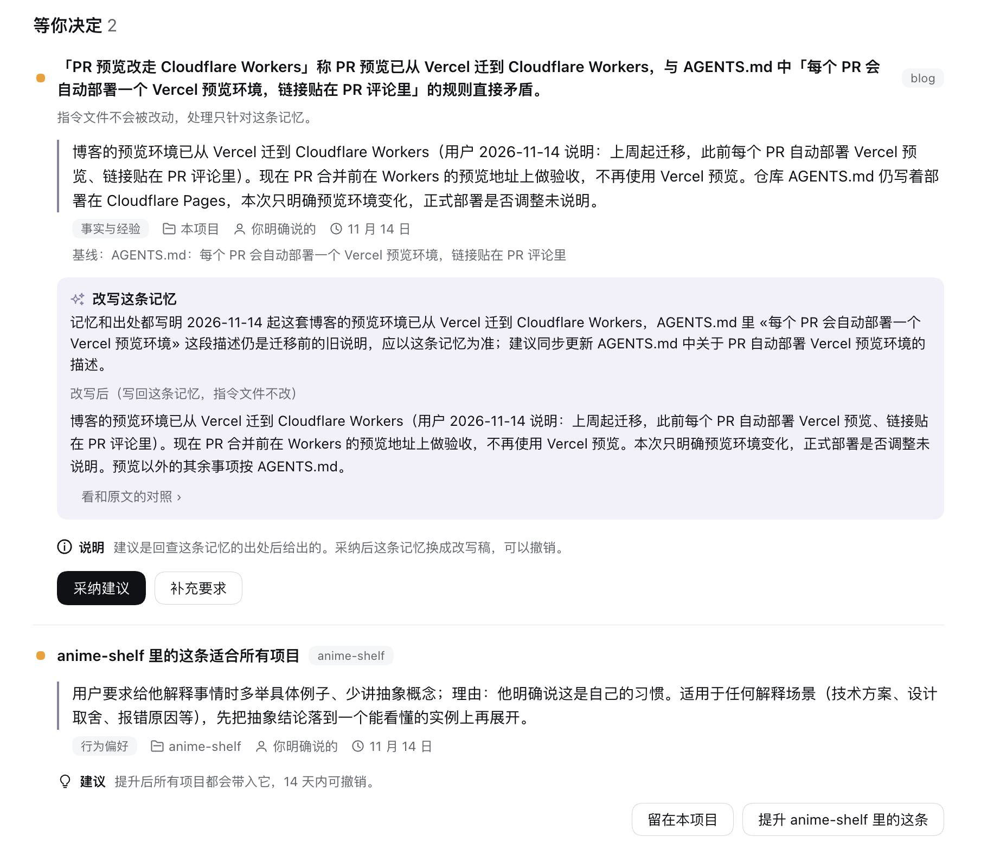
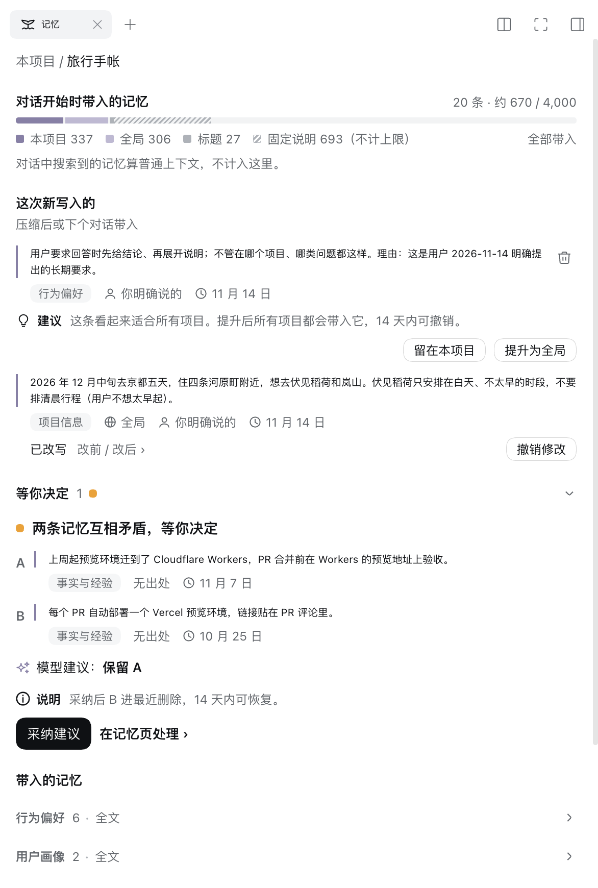
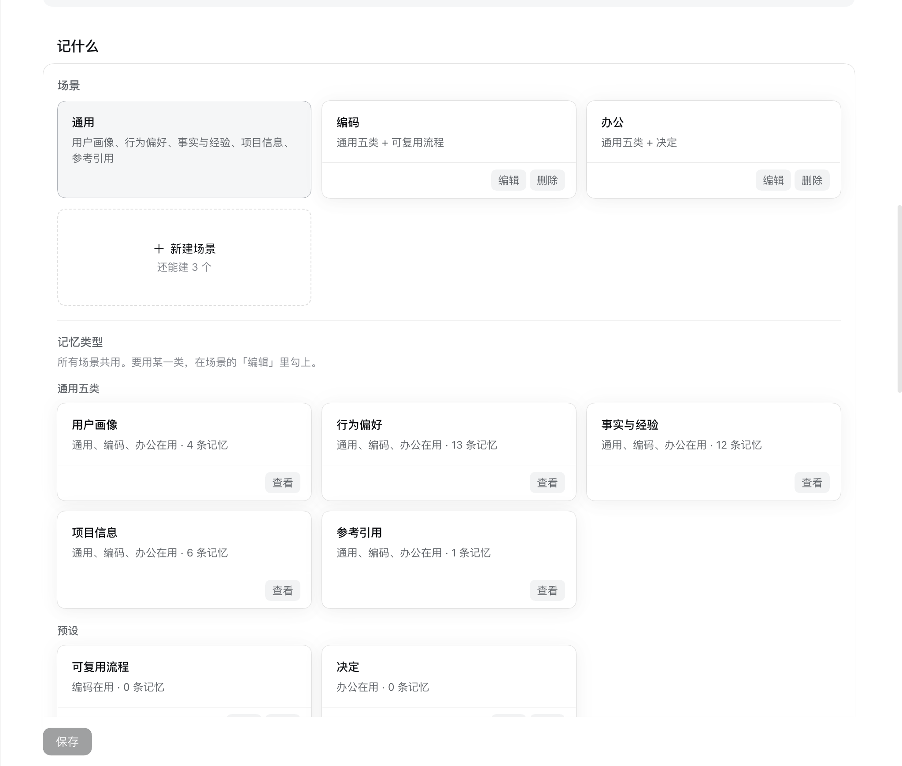

# 常用界面指南

[返回首页](../README.md)

查看、处理、设置记忆都在 DeepSeek Harness 的界面里完成。桌面版和 web 版都支持，桌面版体验最好。

左栏的「记忆」图标在有事等你决定时亮琥珀色圆点，发现密钥时换成红色三角。

## 左栏「记忆」页

<!-- 截图：记忆页整页 -->
<table>
  <tr>
    <td></td>
  </tr>
  <tr>
    <td align="center">记忆页：冲突和全局提升的处理建议</td>
  </tr>
</table>

左边选范围：「全部」、「全局」和各个项目，全局和项目标着记忆条数、健康分，有要处理的事时带件数角标。右边看这个范围，从上到下是标题行、状态条和三个视图。窗口较窄时，左边的范围列表收成顶部的下拉框。

页面不需要开着对话，DeepSeek Harness 里有会话就能用。每次打开都按磁盘上的文件重新读取，在别处改过的文件也会显示出来。

### 标题行

「立即体检」检查当前范围。「自动体检」可设为仅手动（默认）、每天或每 N 天一次（N 取 1 到 90），全局和各项目可以跟随「全部」，也可以单独设置。自动体检在 DeepSeek Harness 开着时于后台进行，用它的默认模型；没开着时不查，打开后补上。

### 状态条

健康分、记忆条数、上次体检和下次自动体检的时间。「分数怎么来的」列出规则检查、内容检查、新鲜度各扣了多少分。体检做完，这里写新增了几条要处理的事、这次大约用了多少 token；指令文件太长只查了一部分、或这次没能读取时，也会注明。

### 处理

要你处理的事分三组：

- **先处理**：密钥和读不出的文件。
- **等你决定**：冲突、适合提升为全局的记忆、带入超出上限的提醒。
- **可以整理**：已过有效期、很久没确认、内容过长、内容重复、放错层、表述不清等建议。

每张卡写明为什么出现、每个选项会怎样，就地处理，动作允许时可以撤销。「不再提醒」让一条建议在记忆改动之前不再出现。

### 记忆查看

按类型分组浏览（「全部」按最近改动的时间分组），可以搜索原文、打开文件、删除。「修改」可以自己改，也可以写下要求让模型改。「选择」一次整理同一范围的 2 到 20 条，模型先列计划、再逐条出稿，你对照确认后才写入，整批可以撤销。

### 最近删除

删掉的记忆保留 14 天，可以恢复、彻底删除、搜索。含密钥的记忆删除时直接彻底删除，不进这里。直接点删除的操作都先确认；采纳模型建议不另外确认，采纳后可以撤销。

## 冲突卡

两条记忆互相矛盾时，模型读过两条记忆（能找到出处时也读它们出自的对话），建议融合成一条、保留其中一条或都保留。你有别的想法，点「补充要求」写下来，模型按你的要求出方案。采纳前不写入任何东西，采纳后可以撤销。

体检后每条新冲突多一次模型调用来出建议；自动体检每次最多准备 10 条，其余的在卡上点「补上建议」。含高危密钥的记忆不会发给模型。

### 和 `AGENTS.md` / `CLAUDE.md` 的冲突

体检把每个项目的记忆和这个项目自己的指令文件对照（也就是在这个项目里开新对话时会读到的那几份），全局记忆和全局的指令文件对照；体检「全部」和自动体检覆盖每个项目。

这类冲突用同样的卡，可以改写这条记忆、以文件为准删掉它，或者都保留。处理只改记忆，指令文件不动，在任何对话里都能处理。指令文件里已经写过的内容，对应的记忆会作为重复内容建议删除。

## 右侧栏「记忆」tab

<!-- 截图：右侧栏「记忆」tab -->
<table>
  <tr>
    <td></td>
  </tr>
  <tr>
    <td align="center">右侧栏「记忆」tab：带入的记忆和这次新写入的记忆</td>
  </tr>
</table>

这次对话带入了哪些记忆（按类型分组，标明带全文、只带摘要还是只带标题）、占了多少上限、模型这次新记了或改写了什么。带入的记忆有冲突时，这里写出模型建议，部分可以直接采纳，其余的到记忆页处理。

## 输入框下方的「记忆」按钮

鲸尾图标。点开看记忆占上下文的比例、用了多少上限、这次带入和新写入了几条，超出上限时可以直接去处理；「查看带入的记忆 ›」打开右侧栏的「记忆」tab。

## 对话里的卡片

模型在哪一轮记下或改写了记忆，回复下方就有一张卡，默认收起成一行「这轮记住了 N 条新记忆」，点开展开。每条都能删除；改写的可以对照改前改后，14 天内能撤销修改；模型认为某条适合所有项目时，卡上可以直接提升为全局。每条的「查看详情 ›」跳到记忆页的这一条，卡上不能直接编辑。

## 插件设置页

<!-- 截图：设置页 -->
<table>
  <tr>
    <td></td>
  </tr>
  <tr>
    <td align="center">插件设置页：场景和记忆类型</td>
  </tr>
</table>

在 DeepSeek Harness 的插件管理里打开本插件的详情。顶部是状态卡，下面分四组：

- **记什么**：选当前场景，新建、编辑、删除场景，管理记忆类型（查看通用五类，改、删、恢复预设类型，增删改自定义类型）。
- **怎么用**：设带入上限、超出上限时的处理方式、什么时候溯源记忆出处。
- **怎么管**：设提醒的灵敏度、跨项目的记忆放到哪里，并列出最近删除的入口和记忆文件位置。
- **外观**：目前可选 DeepSeek 主题蓝色与艾拉主题色。

保存前列出改了哪几项、会有什么影响，确认后写回 profile 的 `cordis.patch.yml`，不用重启，已开着的对话下一步就按新设置来。
