# 常用界面指南

[返回首页](../README.md)

查看、处理、设置记忆都在 DeepSeek Harness 的界面里完成。桌面版和 web 版都支持，桌面版体验最好。

界面分三层，从轻到重：

1. **对话中**：回复下方的卡片、输入框下方的鲸鱼尾按钮、右侧栏「记忆」页签。平时扫一眼就够，不打断对话。
2. **记忆页**：从左栏「记忆」进入，集中处理体检发现的问题，查看、修改、恢复记忆。
3. **插件设置页**：决定记什么、怎么用、怎么管。

## 一、对话中

### 回复下方的卡片

模型在哪一轮记下或改写了记忆，回复下方就有一张卡片，默认收起成一行「这轮记住了 N 条新记忆」，点一下展开。每条都能删除；改写的可以对照改前改后，14 天内能撤销修改；模型认为某条适合所有项目时，卡片上可以直接提升为全局。每条的「查看详情 ›」跳到记忆页的这一条，卡片上不能直接编辑。

<table>
  <tr>
    <td align="center">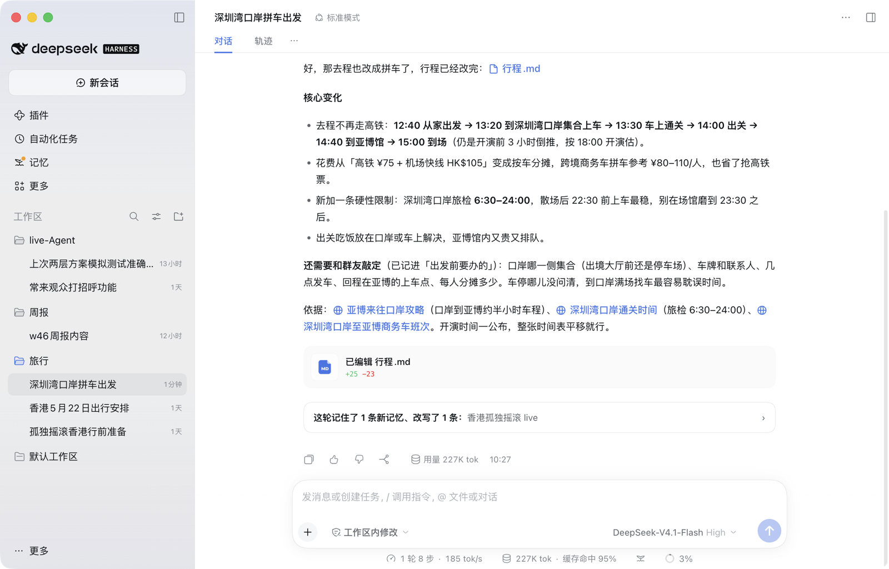 卡片默认收起</td>
    <td align="center"> 点开看详情，更改可一键撤销</td>
  </tr>
</table>

### 输入框下方的鲸鱼尾按钮

点开鲸鱼尾按钮，可以看记忆占上下文的比例、占上限的多少、本轮带入和新写入了几条，超出上限时可以直接去处理；「查看带入的记忆 ›」打开右侧栏的「记忆」页签。

<table>
  <tr>
    <td align="center">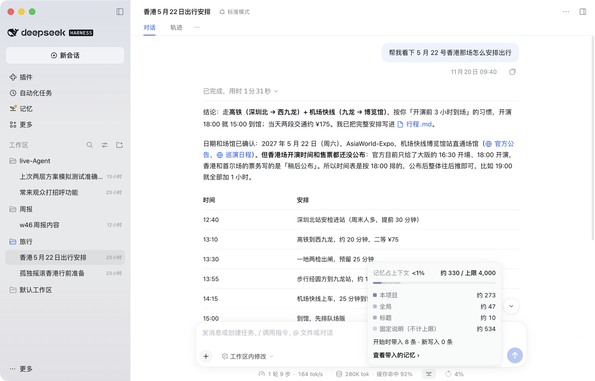 底部鲸鱼小尾巴按钮：快速查看本轮带入的记忆数目</td>
  </tr>
</table>

### 右侧栏「记忆」页签

这里列出本轮带入了哪些记忆（按类型分组，标明带的是全文、摘要还是简单索引）、占上限的多少，以及模型本轮新记了或改写了什么。带入的记忆有冲突时，这里给出模型的建议，部分可以直接采纳，其余的到记忆页处理。

<table>
  <tr>
    <td align="center">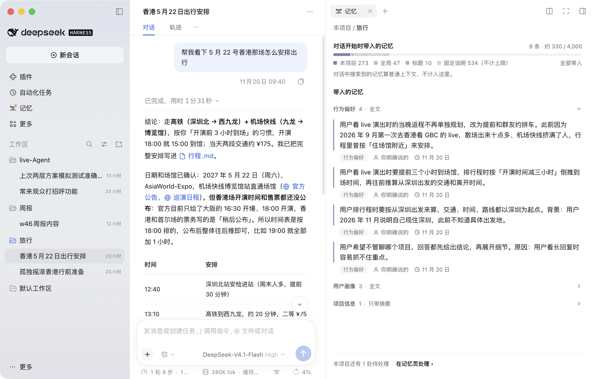 右侧栏：本轮带入的记忆，按类型分组</td>
  </tr>
</table>

## 二、记忆页

左栏的「记忆」图标在有事等你决定时亮琥珀色圆点，发现密钥时换成红色三角，点开就是记忆页。

<table>
  <tr>
    <td align="center">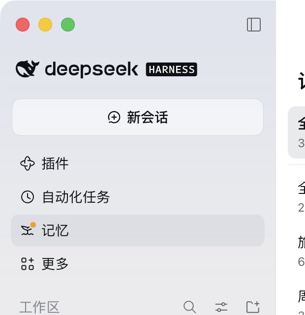 有事等你决定时亮琥珀色圆点</td>
  </tr>
</table>

左边选工作区：「全部」「全局」和各个项目，全局和项目标着记忆条数、健康分，有要处理的事时带数字角标。右边显示所选工作区的内容，从上到下依次是标题行、状态条和三个视图。窗口较窄时，左边的工作区列表收成顶部的下拉框。

记忆页不依赖当前打开的对话，DeepSeek Harness 里有任意一个对话就能用。每次打开都按磁盘上的文件重新读取，在别处改过的文件也会显示出来。

<table>
  <tr>
    <td align="center">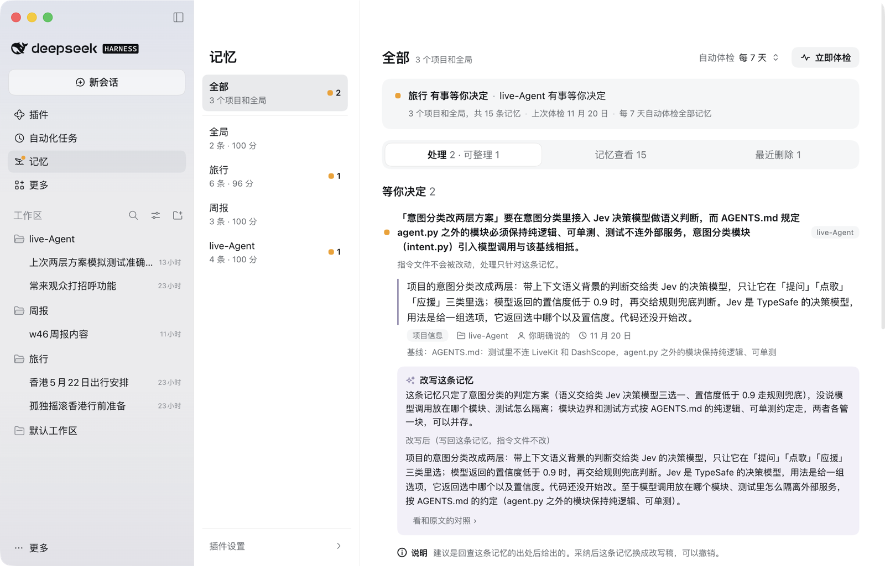 可按工作区查看待处理事项和记忆内容</td>
  </tr>
</table>

### 标题行：体检

「立即体检」检查当前工作区。「自动体检」可设为仅手动（默认）、每天或每 N 天一次（N 取 1 到 90），全局和各项目可以跟随「全部」，也可以单独设置。DeepSeek Harness 开着时，自动体检在后台运行，使用它的默认模型；没开着时不查，打开后补上。

<table>
  <tr>
    <td align="center">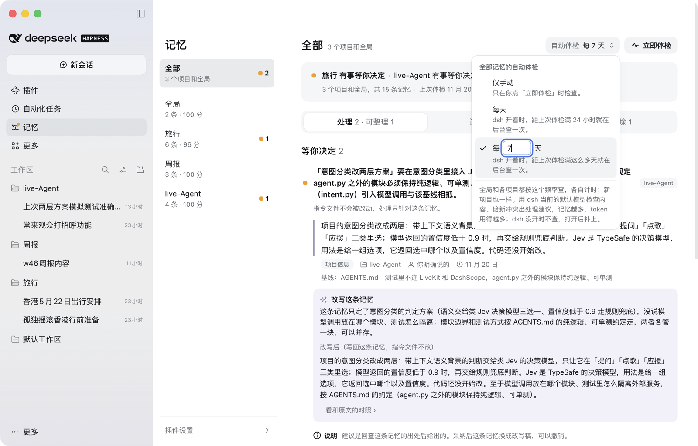 配置自动体检频率和范围</td>
  </tr>
</table>

### 状态条

显示健康分、记忆条数，以及上次和下次体检的时间。「分数怎么来的」列出规则检查、内容检查、新鲜度各扣了多少分。体检做完，这里写新增了几条要处理的事、这次大约用了多少 token；指令文件太长只查了一部分，或者这次没能读取，也会注明。

<table>
  <tr>
    <td align="center">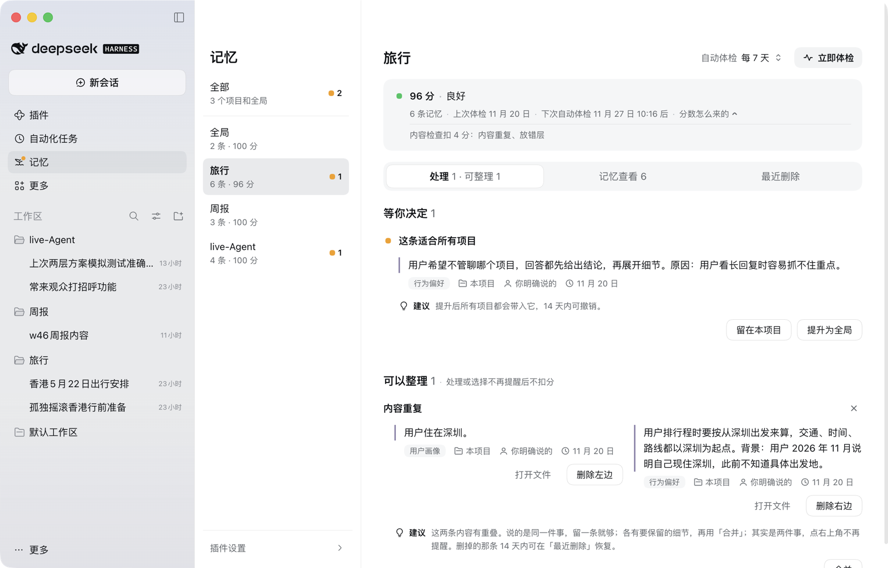 查看健康情况和体检时间</td>
  </tr>
</table>

### 处理

要你处理的事分三组：

- **先处理**：含密钥的记忆、读不出的文件。
- **等你决定**：冲突、适合提升为全局的记忆、带入量超出上限的提醒。
- **可以整理**：已过有效期、很久没确认、内容过长、内容重复、放错层、表述不清等建议。

每张卡片写明出现的原因和每个选项的后果，你直接在卡片上处理；支持撤销的操作，处理后可以撤销。「不再提醒」让一条建议在记忆改动之前不再出现。

#### 冲突卡

两条记忆互相矛盾时，模型先读这两条记忆（能找到出处时，也读它们的来源对话），再建议融合成一条、保留其中一条或都保留。你有别的想法，点「补充要求」写下来，模型按你的要求出方案。采纳前不写入任何东西，采纳后可以撤销。

体检后，每条新冲突会额外调用一次模型来生成建议；自动体检每次最多准备 10 条，其余的在卡片上点「补上建议」。含高危密钥的记忆不会发给模型。

#### 和 `AGENTS.md` / `CLAUDE.md` 的冲突

体检把每个项目的记忆和这个项目自己的指令文件对照（也就是在这个项目里开新对话时会读到的那几份），全局记忆和全局的指令文件对照；体检「全部」和自动体检覆盖每个项目。

这类冲突用同样的卡片，可以改写这条记忆、以文件为准删掉它，或者都保留。处理只改记忆，指令文件不动，在任何对话里都能处理。记忆和指令文件内容重复时，体检会建议删掉这条记忆。

<table>
  <tr>
    <td align="center">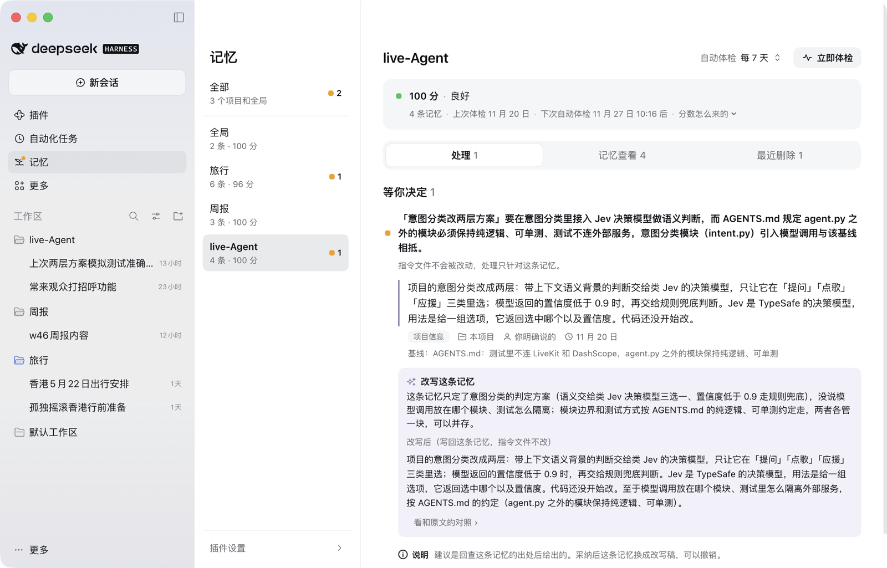 冲突卡：自动分析并给出建议</td>
    <td align="center">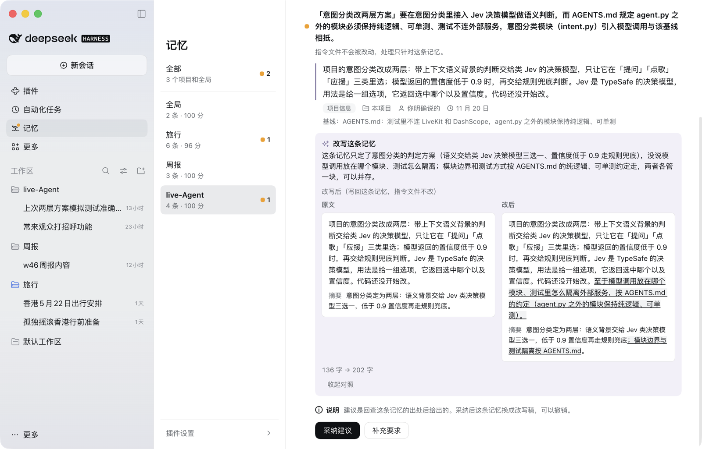 采纳建议前可对照查看或补充要求</td>
  </tr>
</table>

### 记忆查看

按类型分组浏览（「全部」按最近改动的时间分组），可以搜索原文、打开文件、删除。「修改」可以自己改，也可以写下要求让模型改。「选择」一次整理同一工作区的 2 到 20 条，模型先列计划、再逐条给出改写，你对照确认后才写入，整批可以撤销。

<table>
  <tr>
    <td align="center">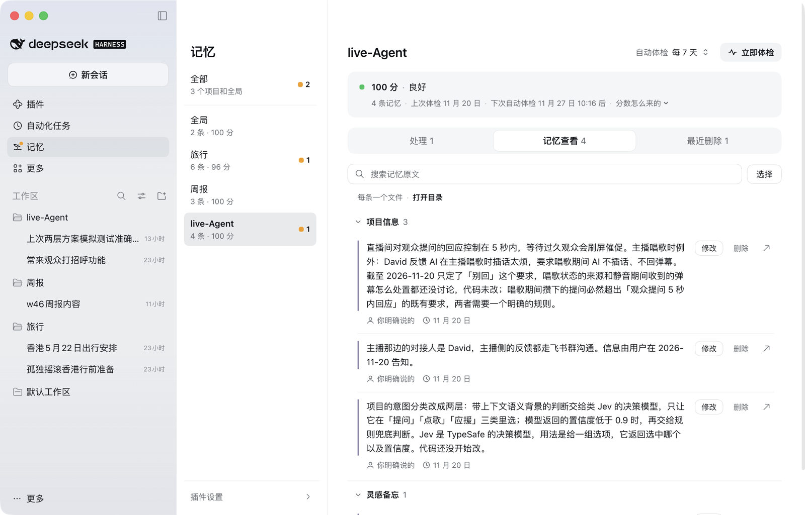 按类型浏览</td>
    <td align="center">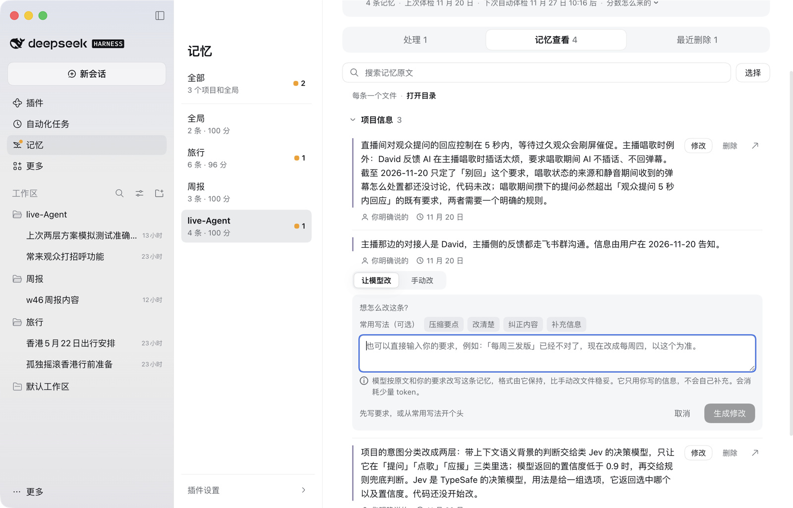 修改记忆可以自己改，也可以让模型代劳</td>
  </tr>
</table>

### 最近删除

删掉的记忆保留 14 天，可以恢复、彻底删除、搜索。含密钥的记忆删除时直接彻底删除，不进这里。手动删除前都会先确认；采纳模型建议不另外确认，采纳后可以撤销。

<table>
  <tr>
    <td align="center">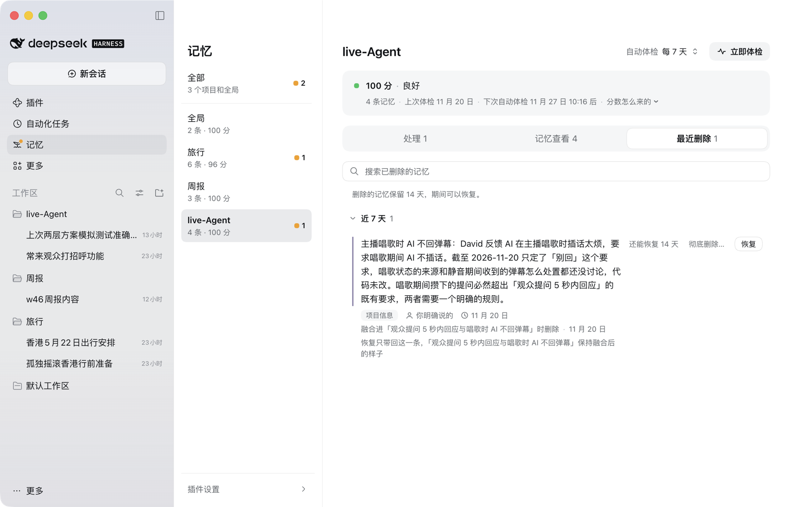 14 天内可以恢复</td>
  </tr>
</table>

## 三、插件设置页

在 DeepSeek Harness 的插件管理里打开本插件的详情，或者点记忆页左下角的「插件设置」。顶部是状态卡，下面分四组。

### 记什么

选当前场景，新建、编辑、删除场景，管理记忆类型（查看通用五类，改、删、恢复预设类型，增删改自定义类型）。

<table>
  <tr>
    <td align="center">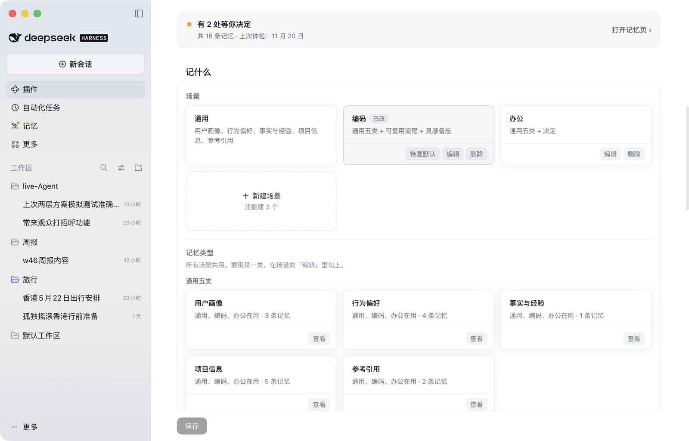 场景：可切换场景和自定义</td>
    <td align="center">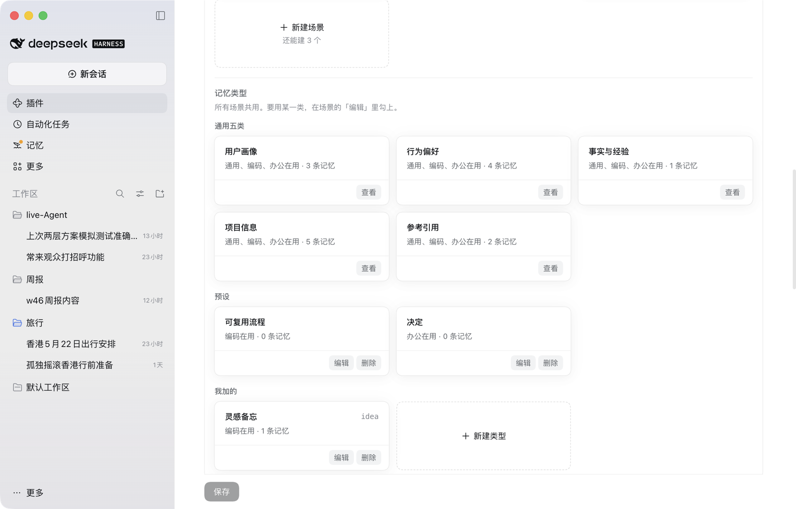 记忆类型：通用五类、预设和自定义</td>
  </tr>
  <tr>
    <td align="center" colspan="2">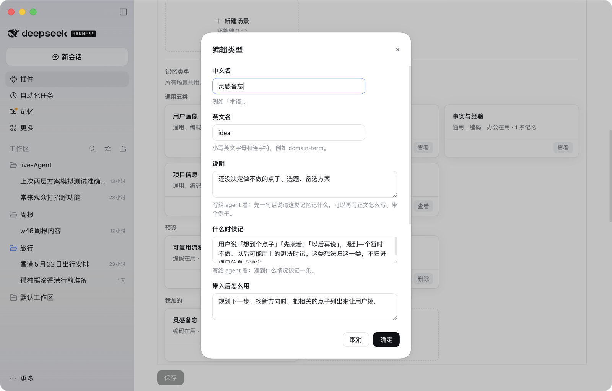 自定义类型：写清记什么、什么时候记、带入后怎么用</td>
  </tr>
</table>

### 怎么用、怎么管

- **怎么用**：设带入上限、超出上限时的处理方式、什么时候追溯记忆出处。
- **怎么管**：设提醒的灵敏度、跨项目的记忆放到哪里。这一组还有最近删除的入口和记忆文件位置。

<table>
  <tr>
    <td align="center">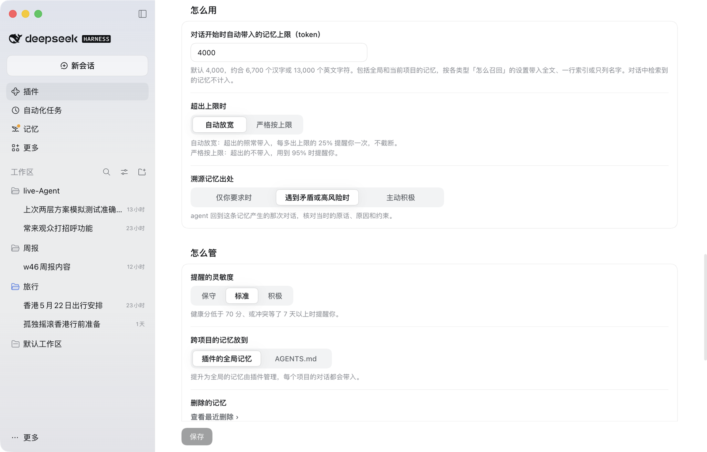 带入上限、溯源和提醒灵敏度</td>
  </tr>
</table>

### 外观

目前可选 DeepSeek 主题蓝色与艾拉主题色。

### 保存

点「保存」后，先列出改了哪几项、各有什么影响，确认后立即生效，不用重启，已打开的对话从下一步起就按新设置来。
